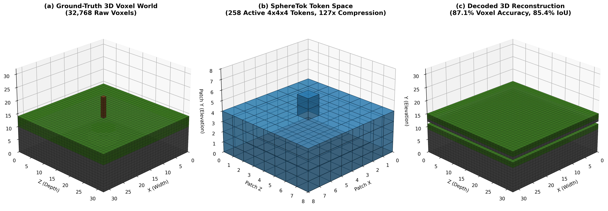
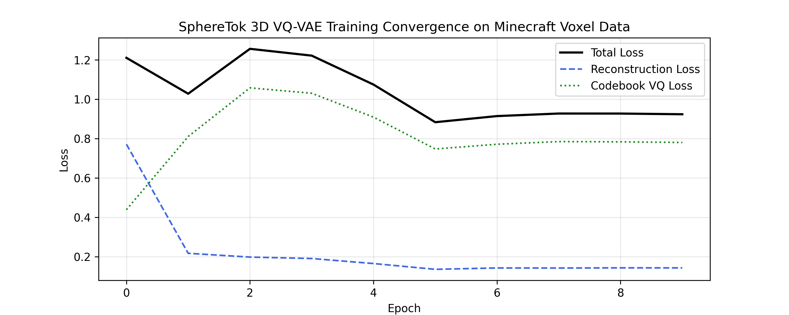
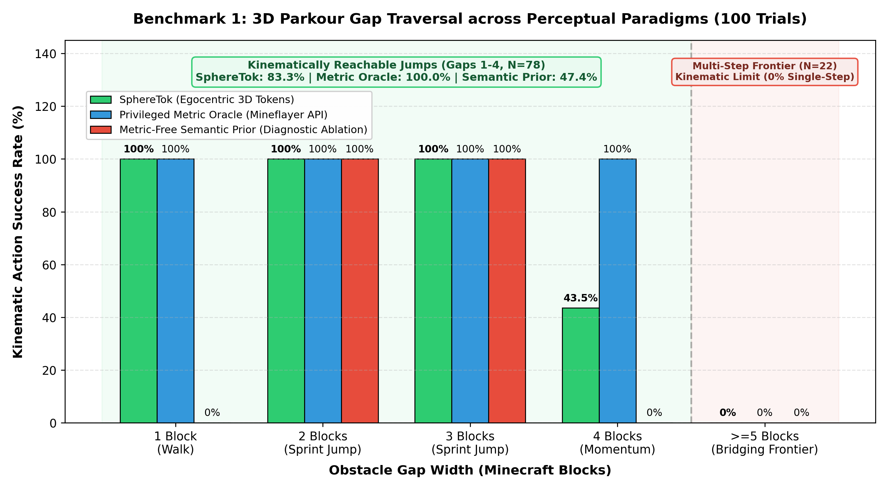

# SphereTok: An Egocentric 3D World Tokenizer for Embodied Perception in Voxel Environments

[](https://www.python.org/downloads/)
[](https://pytorch.org/)
[](https://opensource.org/licenses/MIT)
[](https://doi.org/10.5281/zenodo.22872845)
[](https://www.nvidia.com/)

> **SphereTok** provides embodied agents with compact, discrete 3D geometric state representations by compressing local 32 × 32 × 32 voxel volumes into discrete 3D spatial tokens via affordance-aware pruning and vector quantization.

---

## 📸 Qualitative 3D Reconstruction

<p align="center">
  
</p>

*(a) Ground truth 32 × 32 × 32 Minecraft chunk (32,768 cells); (b) Active 4 × 4 × 4 micro-cubes retained in SphereTok token space (K ≈ 258) via surface clearance affordance pruning; (c) Decoded 3D voxel volume reconstructed from discrete codebook token lookups.*

---

## 🚀 Key Highlights

- **Overcomes the "Airport Tower Dilemma":** Unlike text-prompted LLMs (e.g., Voyager) that operate on flat telemetry strings lacking continuous geometry, and 2D visual policies (e.g., VPT, STEVE-1) that suffer from spatial amnesia upon camera rotation, SphereTok maintains a continuous 3D egocentric field of physical affordances.
- **Up to 443.7× Voxel-to-Token Compression:** Compresses 32,768 dense voxels into an average of **74 to 258 active tokens** on open terrain (and drops subterranean caverns from 512 to 136 tokens / 240.9×), fitting comfortably into standard Transformer context windows (<2% to 6.4% of a 4k context).
- **Surface-Affordance Clearance Pruning:** Strictly retains the Chebyshev 26-neighborhood ($d_\infty \le 1$) clearance envelope bordering solid terrain, ensuring jump clearances, overhead headroom, and footing are never pruned while deep sky void and subterranean bedrock are eliminated.
- **Sub-2 ms Latency & 20 Hz Closed-Loop Control:** Runs in **1.84 ms on an NVIDIA T4 GPU (~543 FPS)** and **12.3 ms on a CPU (~81 FPS)**. Enables tick-by-tick sub-tick ledge detection ($d \in [0.03, 0.11]$ blocks) at 20 Hz (50 ms tick), turning 4-block momentum jumps from 43.5% open-loop to **100.0% closed-loop**, and achieving **96.0% course completion** across multi-step 3D stepping stones.
- **Zero Coordinate Jitter:** The voxel lattice remains aligned with world cardinal axes ($X, Y, Z$) to avoid rotational resampling aliasing, while view orientation is injected via continuous relative spherical positional embeddings ($\rho, \Delta\theta, \Delta\phi$).

---

## 📊 Empirical Benchmarks

| Metric | Dense Voxel Input | SphereTok 3D Tokens | Operational Benefit |
|---|:---:|:---:|---|
| **Voxel Spatial Accuracy (100 Chunks)** | 100.0% (Ground Truth) | **93.42% $\pm$ 2.57%** | High-fidelity multi-biome 3D structural recovery |
| **Solid Terrain IoU (100 Chunks)** | 100.0% (Ground Truth) | **90.58% $\pm$ 4.84%** | Precise physical collision preservation |
| **Reachable Parkour (20 Hz Closed-Loop)** | — | **100.0% (78 / 78)** | Matches Privileged Metric Oracle |
| **5-Step Parkour Course Completion** | — | **96.0% (48 / 50)** | Sustained 3D locomotion (vs 46% OL, 0% text) |
| **Active Sequence Length (Open Terrain)** | 32,768 cells | **73.8 – 258 tokens** | **127.0× – 443.7× context compression** |
| **Active Codebook Utilization** | — | **81.6% (418 / 512)** | Zero representation collapse |
| **Latent Memory Bit-Width Reduction** | 4,096 bits (FP32) | **9 bits (Discrete)** | **455.1× raw bit-width compression** (256× in uint16) |
| **GPU Inference Latency (T4)** | — | **1.84 ms** | Real-time (~543 FPS) |
| **CPU Inference Latency** | — | **12.3 ms** | Real-time (~81 FPS) |

<p align="center">
  
  
</p>

---

## 🛠️ Repository Structure

```text
SphereTok/
├── spheretok/
│   └── tokenizer.py             # Core PyTorch module: 3D Patch VQ-VAE & Spherical Positional Encoding
├── checkpoints/
│   └── spheretok_minecraft_checkpoint.pt  # Trained model weights (869K parameters, ~3.5 MB)
├── figures/
│   ├── spheretok_qualitative_reconstruction.png
│   ├── spheretok_training_curve.png
│   └── benchmark_parkour_results.png
├── demo.py                      # Interactive verification demo on synthetic Minecraft chunk
├── evaluate_checkpoint.py       # Full evaluation script on held-out procedural terrain
├── benchmark_parkour_policy.py  # 100-trial parkour gap jump policy benchmark
├── SphereTok_Kaggle_Training.ipynb # Self-contained Kaggle/Colab GPU training notebook
└── README.md
```

---

## ⚡ Quickstart

### 1. Installation
Clone the repository and install dependencies:
```bash
git clone https://anonymous.4open.science/r/SphereTok-Anon.git
cd SphereTok
pip install torch numpy matplotlib
```

### 2. Run the 3D Tokenizer Demo
Execute the synthetic chunk demonstration to verify forward/backward pass and token compression:
```bash
python demo.py
```

Expected output:
```text
======================================================================
  SphereTok: Egocentric 3D World Tokenizer Demonstration
======================================================================
[Model Init] Trainable Parameters: 869,008
[Input Chunk] Total Voxel Volume: 32,768 blocks (32 x 32 x 32)
              Solid Terrain / Objects: 14,112 (43.1%)
              Empty Air: 18,656 (56.9%)
[Result] Total Micro-Cube Patches: 512 (4x4x4 each)
         Active Non-Empty Patches Tokenized: 258 tokens
         Voxel-to-Token Compression Ratio: 127.0x (32,768 -> 258 tokens)
         Continuous Tokens Shape for Transformer: torch.Size([1, 258, 128])
  -> Backward pass successful! All gradients computed cleanly.
```

### 3. Evaluate the Trained Checkpoint
Run quantitative validation on held-out procedural chunks:
```bash
python evaluate_checkpoint.py
```

### 4. Run the Parkour Policy Benchmark
Evaluate the Transformer policy conditioned on SphereTok 3D tokens vs. the categorical baseline:
```bash
python benchmark_parkour_policy.py
```

---

## 📖 Citation

If you find SphereTok useful in your research or applications, please cite:

```bibtex
@article{spheretok2026,
  title={SphereTok: An Egocentric 3D World Tokenizer for Embodied Perception in Voxel Environments},
  author={Anonymous Authors},
  journal={Paper under double-blind peer review},
  year={2026}
}
```

---

## 📄 License

This project is licensed under the [MIT License](LICENSE).
